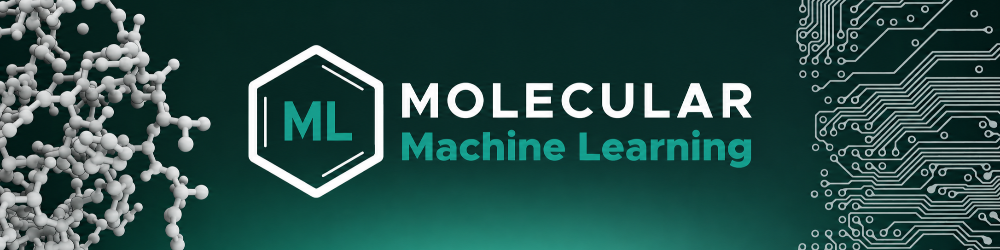

🌐 [molecularmachinelearning.com](https://molecularmachinelearning.com/)

We develop AI methods for drug discovery at the [Eindhoven University of Technology](https://www.tue.nl/), bringing together chemistry, biology and machine learning. We believe in open and reproducible research, so the code behind our papers is shared here.

**Some examples of what we do**
- [ACER](https://github.com/molML/acer): generalizable protein–ligand co-folding · [NeurIPS 2026](https://doi.org/10.64898/2026.06.02.728568)
- [JointMolecularModel](https://github.com/molML/JointMolecularModel): estimating how "unfamiliar" a molecule is to a model · [Nature Machine Intelligence](https://www.nature.com/articles/s42256-026-01216-w)
- [MoleculeACE](https://github.com/molML/MoleculeACE): benchmark ML models on activity cliffs
- [peptidy](https://github.com/molML/peptidy): peptide processing for machine learning
- [ChemLint](https://github.com/molML/ChemLint): MCP server that lets LLMs handle molecular data
- [molforge](https://github.com/molML/molforge): molecular data curation and conformer generation

Browse [all repositories](https://github.com/molML?tab=repositories) for the code of our papers.
